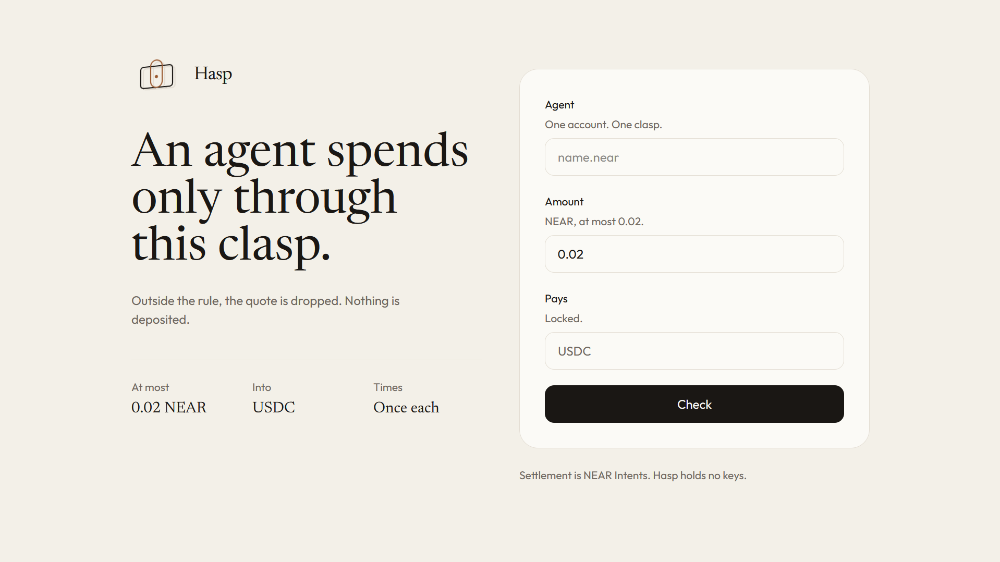
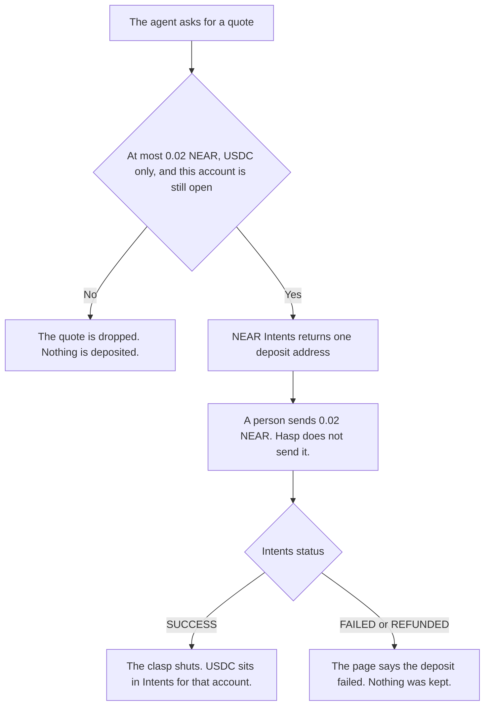

<p align="center">
  
</p>

<h1 align="center">Hasp</h1>

<p align="center">
  An agent may swap NEAR only inside a rule.
</p>

<p align="center">
  <a href="https://theclasp.vercel.app"></a>
  
  
  
  <a href="LICENSE"></a>
</p>

An agent that can pay can also spend too much, pay the wrong coin, or pay again. Hasp is the lock in front of that payment. The agent may ask for a swap. The swap is allowed only when it is at most 0.02 NEAR, only into USDC, and only once for that account. Anything else is dropped, and nothing is deposited.

Site: https://theclasp.vercel.app



Track: Agent Economy (`agents`).

## What it does

Hasp holds no keys and cannot send NEAR. A quote that fits can open one NEAR Intents deposit address. Until that NEAR arrives, nothing is deposited. If the deposit fails, the page says so. The clasp is marked settled only when NEAR Intents reports `SUCCESS`.



## What happened

Account `sithunyein.near`.

One deposit of 0.02 NEAR was refunded. NEAR Intents reported `REFUNDED` with reason `NO_LIQUIDITY`. The 0.02 NEAR went back to that account. The page said the deposit failed and nothing was kept.

A second deposit settled. NEAR Intents reported `SUCCESS`: 0.02 NEAR in, 0.082181 USDC out, nothing refunded. The USDC is in the Intents balance for `sithunyein.near`, not in the NEAR balance of a wallet. The page now says the clasp is shut and will not open again for that account.

Deposit address: `aec93e908cfb10059e100ced9b324da6bc0bc4aa321fff98c39c0a4af7356a93`

Status: https://1click.chaindefuser.com/v0/status?depositAddress=aec93e908cfb10059e100ced9b324da6bc0bc4aa321fff98c39c0a4af7356a93

NEAR transactions: [9kPEnrpySh2X7qzoYAepsSbqofMENPYTWZUh28ivqCp](https://nearblocks.io/txns/9kPEnrpySh2X7qzoYAepsSbqofMENPYTWZUh28ivqCp), [xDrRSHsxmpQNB8JzmqddVTtwqKQRq2W61xLaC5dXJUL](https://nearblocks.io/txns/xDrRSHsxmpQNB8JzmqddVTtwqKQRq2W61xLaC5dXJUL)

## Do this

From this repository, with Node. The 0.03 command is refused before any quote is asked for. The 0.02 command asks for a dry quote. Neither deposits anything.

```sh
node scripts/hasp-agent.mjs 0.03 name.near
```

See `DROPPED`. No quote was asked for. Nothing is deposited.

```sh
node scripts/hasp-agent.mjs 0.02 name.near
```

See `FITS`, then a USDC amount. Nothing is deposited.

On https://theclasp.vercel.app:

1. Enter an agent account that has not settled. Amount `0.03`. Check. It is refused before any quote is asked for.
2. Amount `0.02`. Check. The quote fits. Nothing is deposited yet.
3. Open deposit. An address appears, or the page says the deposit failed. Send the 0.02 NEAR yourself.
4. Read status. The clasp stays open until Intents says `SUCCESS`. A failure reopens it and says so.

`sithunyein.near` is already shut. A second account can still try. The rule is per account.

The demo shows the cap drop and the settled swap. The amount parsing, the account check, and the cap are pinned by [`src/lib/hasp/rule.test.ts`](https://github.com/thesithunyein/hasp/blob/main/src/lib/hasp/rule.test.ts), and the drop-before-quote order is pinned by [`scripts/hasp-agent.test.mjs`](https://github.com/thesithunyein/hasp/blob/main/scripts/hasp-agent.test.mjs).

## NEAR

The quote is a mainnet NEAR Intents 1Click quote. Origin is wrapped NEAR. Destination is USDC, paid into Intents for that account. Intents settles the swap across chains, so the agent never needs a USDC account or gas on another chain; it holds no key at all. There is no testnet for Intents. The agent script uses a dry quote. The site asks for a deposit address only after the rule fits.

## Project

```
src/lib/hasp/rule.ts          the rule: 0.02 NEAR, USDC, once
src/lib/hasp/fn.ts            check, open a deposit, read status
src/routes/index.tsx          the page
src/components/mark.tsx       the mark
scripts/hasp-agent.mjs        dry quote, deposits nothing
migrations/0003_hasp_agent.sql  one row per account
public/favicon.png            the browser icon
docs/logo.png                 the mark used above
LICENSE                       MIT
SECURITY.md                   how to report a problem
CODE_OF_CONDUCT.md            how to take part
CONTRIBUTING.md               what a patch may not change
docs/home.png                 the page shown above
```

The site is the app in `src/`. The files above are the clasp.

## The other project

This is the second project. The first is [Kyrona](https://github.com/thesithunyein/kyrona), a spending desk with its own contract and its own key. Hasp does not use that contract, that key, or that desk. The two share no product code. Both repositories started from the same Grok App Builder shell, so those generated files are identical in each; the clasp (`src/lib/hasp/`, `src/routes/index.tsx`, `scripts/hasp-agent.mjs`, `migrations/0003_hasp_agent.sql`) is Hasp's alone.

## Built with

Written for this hackathon, from 1 November 2026. The app shell (TanStack Start, React, Vite, the auth and preview wiring under `src/lib/auth`, `src/lib/app-data`, `server/` and most of `scripts/`) came from a Grok App Builder export. The clasp itself is new: the files listed under Project. Parts of the code were written with AI assistance. Settlement uses the NEAR Intents 1Click API.

## What this does not enforce

- The rule is checked by this site and stored in its database. An agent that calls the NEAR Intents 1Click API directly, without Hasp, is not stopped. Hasp shows what a rule in front of a swap looks like; it is not an on-chain lock.
- There is no sign-in. Anyone can enter any account and open that account's one clasp, which then counts as used.
- Send the deposit from the agent account itself. The quote sets that account as the refund address, so a failed swap refunds it, not whoever sent the NEAR.

## What this is not

- Not a wallet, and not a key.
- Not a job board, a chat, or a second spending desk.
- A dry quote is not a deposit.
- A deposit address is not a settled swap.
