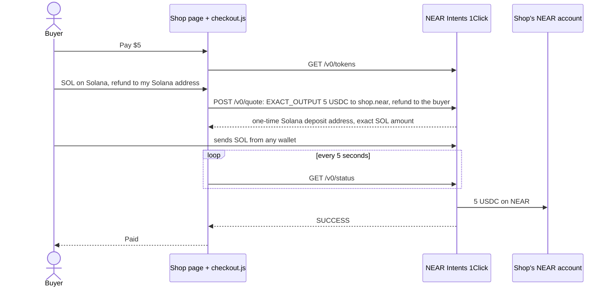

<p align="center">
  
</p>

<h1 align="center">Hasp</h1>

<p align="center">
  Checkout for almost any coin. Exact USDC arrives on NEAR.
</p>

<p align="center">
  <a href="https://thehasp.vercel.app"></a>
  <a href="https://github.com/thesithunyein/hasp/actions/workflows/ci.yml"></a>
  
  <a href="LICENSE"></a>
</p>

A shop that wants crypto has to pick which chains and coins to accept, and its buyers rarely hold the right one. Hasp is one script tag. The buyer pays with whatever they hold, on NEAR, Ethereum, Base, Arbitrum, Solana, Bitcoin or dozens of other chains, and the shop receives the exact USDC it asked for in its NEAR account. NEAR Intents does the conversion and the settlement. Hasp has no server, no sign-up and no keys, and never holds the funds.

```html
<script src="https://thehasp.vercel.app/checkout.js"
        data-to="yourname.near" data-usd="5" data-item="A coffee"></script>
```

It is the "universal checkout widget" from [Illia Polosukhin's list of things to build on NEAR](https://crypto.news/near-co-founder-pitches-ai-pets-private-trading/) (3 October 2026): customers pay through NEAR Intents with whatever wallet and chain holds their assets.

Tracks: Agent Economy (`agents`) and Real-World Money (`realworld`).

## Try it

No wallet is needed for steps 1 to 3. Nothing moves until a buyer sends coins to the address the quote gives.

| Do | See |
|---|---|
| 1. Open [thehasp.vercel.app](https://thehasp.vercel.app), choose **Tip $1**, pick a coin, give a refund address on that coin's chain | A one-time deposit address from NEAR Intents and the exact amount to send, for example `0.286647 NEAR`. The status line reads "Waiting for your payment…" |
| 2. Open [the demo shop](https://thehasp.vercel.app/shop.html) | The same button on a plain HTML page with no framework: two `<script>` tags, two prices |
| 3. In **Get a button** on the site, enter a NEAR account and a price | The tag to paste, and a live preview of the button it makes |
| 4. `node scripts/hasp-agent.mjs buy --to sithunyein.near --usd 1 --item "A coffee"` | `rule` allows it, then a live mainnet `quote`, then `dry run  nothing sent` |
| 5. `node scripts/hasp-agent.mjs buy --to stranger.near --usd 1` | `STOPPED: stranger.near is not on the agent's list of merchants`, exit code 2, no quote asked for |
| 6. `npm ci && npm test` | 17 tests pass: prices, accounts, refund addresses, the coin list, the exact quote, the agent's rule |

Steps 4 and 5 also run on every push in [CI](https://github.com/thesithunyein/hasp/actions/workflows/ci.yml): open a run and read the notices "Agent dry run (mainnet quote, nothing sent)" and "Agent stopped by its rule (exit 2)".

## Add it to a page

```html
<!-- One button where the tag is -->
<script src="https://thehasp.vercel.app/checkout.js"
        data-to="yourname.near" data-usd="5" data-item="A coffee" data-label="Buy a coffee"></script>

<!-- Or several, anywhere, with one script tag -->
<div data-hasp-to="yourname.near" data-hasp-usd="3" data-hasp-item="Lunch"></div>
<script src="https://thehasp.vercel.app/checkout.js"></script>
```

| Attribute | Meaning |
|---|---|
| `data-to` | Your NEAR account. The USDC is paid here. |
| `data-usd` | The price in dollars, like `5` or `4.50`, up to 10,000. You receive exactly this much USDC. |
| `data-item` | Optional. What the buyer is paying for. |
| `data-label` | Optional. The button text. Default: `Pay $5`. |

From JavaScript: `Hasp.open({ to: "yourname.near", usd: "5", item: "A coffee" })`. When NEAR Intents reports `SUCCESS`, the button fires a `hasp:paid` event with `{ to, usd, item, depositAddress, amountOut }`. The event comes from the buyer's browser, so before you ship anything, confirm the payment yourself: `GET https://1click.chaindefuser.com/v0/status?depositAddress=...` must say `SUCCESS`, or check your NEAR account.

The button and its window draw inside a shadow root, so a page's CSS cannot break them and they cannot change the page.

## How a payment moves



The page talks to the 1Click API directly from the buyer's browser. Hasp's own site only serves the script.

## NEAR

- **NEAR Intents, 1Click API.** Each payment is one `EXACT_OUTPUT` quote: the output is fixed at the shop's price in USDC, and Intents works out the input. `depositType: ORIGIN_CHAIN` gives an address on the buyer's own chain. `recipientType: DESTINATION_CHAIN` with destination `nep141:17208628…36133a1` (native USDC on NEAR) pays the shop's NEAR account, not an Intents balance. `refundType: ORIGIN_CHAIN` sends any refund to the buyer's address on their own chain.
- **Any chain in, one account out.** On 11 November 2026, `GET /v0/tokens` listed 229 tokens on 39 chains. The coin list in the window comes from that call, so new coins appear without a release. BNB Chain and Tron have high minimums on Intents ($1,000 and $100), so they only appear for prices at least that large.
- **NEAR accounts as the shop's address.** A shop is a NEAR account like `yourname.near`, not a hex address per chain.

## Proof on mainnet

Live quotes on 11 November 2026 for exactly 1.00 USDC to `sithunyein.near` (dry, nothing sent):

| Buyer pays with | Quote | Estimated time |
|---|---|---|
| NEAR | 0.2848 NEAR (≈ $1.017) | 22 s |
| USDC on Base | 1.014689 USDC | 35 s |
| SOL on Solana | 0.012288631 SOL | 22 s |

An earlier swap through the same API settled on mainnet: 0.02 NEAR in, 0.082181 USDC out, status [`SUCCESS`](https://1click.chaindefuser.com/v0/status?depositAddress=aec93e908cfb10059e100ced9b324da6bc0bc4aa321fff98c39c0a4af7356a93), NEAR transactions [9kPEnrpy…](https://nearblocks.io/txns/9kPEnrpySh2X7qzoYAepsSbqofMENPYTWZUh28ivqCp) and [xDrRSHsx…](https://nearblocks.io/txns/xDrRSHsxmpQNB8JzmqddVTtwqKQRq2W61xLaC5dXJUL). A first attempt was refunded with `NO_LIQUIDITY`, and the 0.02 NEAR came back.

## For AI agents

`scripts/hasp-agent.mjs` lets an agent pay at any Hasp checkout. It asks for the same `EXACT_OUTPUT` quote a person's button asks for, pays the deposit address in NEAR from its own account, tells Intents the transaction hash, and waits for `SUCCESS`.

Before it asks for anything, it checks its rule in [`scripts/agent-rule.json`](scripts/agent-rule.json): only merchants on its list, at most `$2` per purchase and `$5` a day (UTC), counting only purchases that settled. Outside the rule it stops with exit code 2 and asks for no quote. Each settled purchase goes into `.hasp-agent-log.json` (ignored by git).

```sh
node scripts/hasp-agent.mjs buy --to sithunyein.near --usd 1 --item "A coffee"           # dry run
HASP_AGENT_ACCOUNT=agent.near HASP_AGENT_KEY='ed25519:...' \
  node scripts/hasp-agent.mjs buy --to sithunyein.near --usd 1 --item "A coffee" --send   # pays
```

The rule is the agent's own discipline, not a lock: a key that can send NEAR can also be used without this script. Give the agent an account that holds only what it may spend.

## What Hasp does not do

- "Paid" and `hasp:paid` come from the buyer's browser. A shop that delivers something should confirm `SUCCESS` with the status link or its own NEAR account.
- Without a NEAR Intents partner key, 1Click adds a 0.25% fee, inside the quoted amount the buyer pays. Hasp adds no fee.
- A buyer who sends less than the quote, or after the address goes cold, is refunded to the address they gave. Refunds are handled by NEAR Intents, not by Hasp.
- The refund address check is a format check per chain. It cannot know whether the buyer controls that address.
- There is no list of a shop's past payments yet. The shop sees each payment arrive in its NEAR account.

## Code

```text
public/checkout.js            the widget: coin list, quote, deposit address, status, refund address
public/shop.html              a plain HTML page using it
src/routes/index.tsx          the site: live button, button maker, how it works
src/components/mark.tsx       the mark
scripts/hasp-agent.mjs        an agent paying at a checkout, inside its rule
scripts/agent-rule.mjs        the rule: merchants, per purchase, per day
scripts/agent-rule.json       the rule the agent runs with
scripts/checkout.test.mjs     tests for the widget's logic
scripts/hasp-agent.test.mjs   tests for the rule and the agent's refusals
.github/workflows/ci.yml      tests, the agent against live Intents, and what a reviewer runs
docs/logo.png                 the logo above
```

`npm test` runs Hasp's tests. `npm run test:shell` runs the generated app shell's own tests; they read the Grok App Builder's workspace files under `.grok/`, which are not in this repository, so several fail here. None of them test Hasp.

CI runs on every push: the widget and agent tests; the agent's dry run and its refusal against live NEAR Intents; and `npm ci`, `npm test`, the type check, `npm run build` and `npm run dev` answering on port 8080 with `/checkout.js` served.

## Run it

```sh
npm ci
npm run dev        # http://127.0.0.1:8080, the widget at /checkout.js, the demo shop at /shop.html
npm test
```

## How it got here

Hasp was submitted on 1 November as a rule in front of one swap: an agent could swap at most 0.02 NEAR, only into USDC, once per account. That rule lived in the site's database, so an agent that called NEAR Intents directly was not stopped, and the README said so. On 11 November it became the checkout above. The rule idea moved into agent mode, where an agent's purchases are checked against its own list and limits before any quote. The old swap, its database table (`migrations/0003_hasp_agent.sql`) and its proof are kept in the history.

## The other project

This is the second project. The first is [Kyrona](https://github.com/thesithunyein/kyrona), spending limits for AI agents enforced by a NEAR contract with its own key. Hasp does not use that contract, that key or that desk, and the two share no product code. Both repositories started from the same Grok App Builder shell, so those generated files are identical in each; the checkout (`public/checkout.js`, `public/shop.html`, `src/routes/index.tsx`, `scripts/hasp-agent.mjs`, `scripts/agent-rule.*`) is Hasp's alone.

## Built with

Written for this hackathon, from 1 November 2026. The app shell (TanStack Start, React, Vite, the auth and preview wiring under `src/lib/auth`, `src/lib/app-data`, `server/`, `migrations/auth`, and the build and preview helpers in `scripts/`) came from a Grok App Builder export. Everything listed under Code is new. Parts of the code were written with AI assistance. Settlement uses the NEAR Intents 1Click API. The agent signs with `@near-js`.

## License

[MIT](LICENSE). Copyright 2026 Sithu Nyein.
